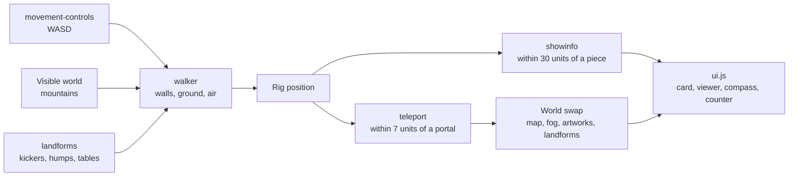

# Transcendence

A gallery you ride through in the browser. Four neon worlds, fifteen artworks, portals between them, and terrain you can launch off.

## Why I built it

Transcendence was freelance work for an indie art gallery. They wanted their collection shown the way the pieces look: loud, low-poly and a little strange. So instead of a white room with frames, it is a set of worlds you cross on a board. You ride up to a piece to read it, and into a portal to leave the world you are in. The wireframe mountains, the sky and the avatar follow the gallery's own style.

## What it does

- Third-person riding, with the camera orbiting the avatar as you drag
- Terrain that stops you: mountains are walls, and you slide along them
- Kickers, humps and tables that rise out of each world's floor and throw you into the air
- A boost on Space and a hop on Shift, with an air-time readout when you land a real jump
- Portals that swap the whole world under a flash of the next world's colour
- 15 artworks, each with a ring on the floor, a plate with its number and title, a caption card when you are close, and a full-screen view on E
- A compass that points at the nearest piece you have not read yet, and a count of the ones you have
- A looping soundtrack that starts when you enter

## How it works

The scene is A-Frame 0.8.2. It is one HTML file, a stylesheet and five small scripts, with every model, texture and sound beside them. There is no build step.



### Walls, ground and air

`movement-controls` only moves the rig sideways and forwards. `walker` decides whether each of those steps is allowed and owns the height.

Before a step is accepted, one ray is cast straight down 4 units ahead of the rig. Mountain ground higher than 2.5 units refuses the step, and so does a landform face that rises more than 2.5 units from where you stand. A refused step is tried again on each axis alone, so you slide along a slope instead of sticking to it.

While grounded, the rig follows the surface under it and remembers how fast that surface was lifting it. When the surface drops away, at the lip of a kicker, the rig leaves with that upward speed times 1.25 and falls at 34 units per second squared until it meets the ground again. That is the whole of the physics: there is no engine behind it.

### Landforms in the world's own material

Each kicker, hump and table is generated at load from a profile curve, with its inner points nudged off the grid by a seeded generator so the faces come out uneven. It takes the two materials of the map it stands in: the dark faceted faces, and the glowing wire, drawn as one thin beam per edge. So a ramp reads as part of the landscape, in that world's colour, and it is the same shape on every load.

### Portals that swap worlds

A portal checks its distance to the rig on the floor plane. Inside 7 units it fires once: the page flashes the next world's colour, and under the flash the map, the fog, the artworks, the landforms and the portals are swapped and the rig is set down at that world's spawn. All four maps sit in one scene, so a swap loads nothing. One portal leads back and is moved into each world you enter.

### Artworks

Each piece announces when you come within 30 units and when you leave. The page draws the rest: a caption card with the piece's number, title and text, a full-screen view on E that holds the rider still, the count of pieces seen, and the compass, which is the bearing to the nearest unread piece turned into a rotation.

## Tech stack

- A-Frame 0.8.2, aframe-extras (`movement-controls`, `animation-mixer`), aframe-particle-system-component
- Plain JavaScript components: `walker`, `landforms`, `teleport`, `showinfo`, and `ui.js` for the page
- glTF worlds, avatar and portal, a painted sky, an MP3 soundtrack
- Syne and Space Mono from Google Fonts

## Running it

Any static file server works. The libraries load from CDNs, and every model, texture and sound is a file in this repo.

```bash
npx serve .
# or
python -m http.server 8080
```

Then open the address it prints.

| Key | Does |
| - | - |
| W A S D | ride |
| drag | look around |
| Space | boost, while held |
| Shift | hop |
| E | open the piece you are standing at, and close it |

## Known gaps

- It runs on a screen with a keyboard. It never enters a headset: A-Frame 0.8.2 predates WebXR and the VR button is off.
- Touch devices can look around but there is no on-screen control for boost, hop or the viewer.
- All portals share one model. The green, pink and blue portal models and a second avatar lived only on Glitch's CDN, which no longer serves them.
- The third and fourth worlds have 3 and 0 artworks. The gallery's 15 pieces are hung 12 and 3.

## Status

Everything listed above runs, checked in Chrome on desktop.
