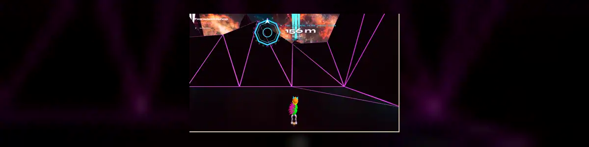
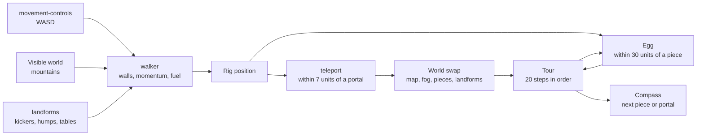

# Transcendence

A gallery you ride through in the browser. Fifteen artworks wait in sealed eggs across four neon worlds, and they open only in order.

## Why I built it

Transcendence was freelance work for an indie art gallery. They wanted their collection shown the way the pieces look: loud, low-poly and a little strange. So instead of a white room with frames, it is a set of worlds you cross on a board. The wireframe mountains, the sky and the avatar follow the gallery's own style.

## What it does

- Third-person riding, with the camera orbiting the avatar as you drag
- Terrain that stops you: mountains are walls, and you slide along them
- Kickers, humps and tables that rise out of each world's floor and throw you into the air
- Nitro on Space and a jump on Shift, both drawing on one tank of fuel
- Fifteen pieces, each sealed in a chained gold egg until its turn comes
- A tour of 20 steps: the 15 pieces and the 5 portal crossings between them
- A compass that points at the next step, a piece or the portal to take, with the fuel as a ring round it
- Four named worlds, each with its own colour and sigil, and portals that swap one for the next
- A full-screen view of a piece on E, a collection of what you have opened on C, and an end screen with your time
- A looping soundtrack that starts when you enter

## How it works

The scene is A-Frame 0.8.2. It is one HTML file, a stylesheet and five small scripts, with every model, texture and sound beside them. There is no build step.



### A tour, with the portals as steps

The route is one list of 20 steps: 15 pieces and 5 portal crossings. The compass points at the first step not done. For a portal it shows the destination's name, colour and sigil, the same three things that are on the portal's own sign.

| World | Pieces |
| - | - |
| The Threshold | 01 to 03 |
| The Thought Fields | 04 to 08 |
| The Grove of Shapes | 09 to 12 |
| The Quiet Deep | 13 to 15 |

### An egg opens only on its turn

Each piece is hidden in a chained egg lit gold, the one colour none of the four worlds uses. Coming within 30 units opens it only if it is the tour's next step. Out of turn it shivers, and a card says which piece comes first.

### One ray decides if a step is allowed

`movement-controls` only moves the rig sideways and forwards. `walker` decides whether each of those steps is allowed and owns the height. Before the rig moves, a ray is cast straight down 3 units ahead. Ground more than 4.5 units above the rider's feet refuses the step, and four height samples turn the rider along the face, so you slide along a slope instead of sticking to it. A portal is rock all the way round except 42 degrees either side of its mouth.

The rider keeps momentum and loses it to friction, and falls at 26 units per second squared. That is the whole of the physics: there is no engine behind it.

### Nitro and jumps on one tank

Space winds the speed up to 2.6 times over 2.4 seconds and would empty the tank in 6. Shift jumps about 14 units and burns a quarter of it, in the air too. The tank takes 22 seconds to refill and only starts after 1.5 seconds without use.

### Landforms in the world's own material

Each kicker, hump and table is generated at load from a profile curve, with its inner points nudged off the grid by a seeded generator so the faces come out uneven. It takes the two materials of the map it stands in, so a ramp reads as part of the landscape, in that world's colour, and it is the same shape on every load.

### Portals that swap worlds

A portal checks its distance to the rig on the floor plane. Inside 7 units it fires once: the page flashes the next world's colour, and under the flash the map, the fog, the pieces, the landforms and the portals are swapped and the rig is set down at that world's spawn. All four maps sit in one scene, so a swap loads nothing.

The picture inside a portal is placed with `KHR_texture_transform`, which the loader in A-Frame 0.8.2 does not read, so it came out shifted and stretched. The file's own offset and scale are applied by hand once the model loads.

## Tech stack

- A-Frame 0.8.2, aframe-extras (`movement-controls`, `animation-mixer`), aframe-particle-system-component
- Plain JavaScript components: `walker`, `landforms`, `teleport`, `showinfo`, and `ui.js` for the page
- glTF worlds, avatar and portal, a painted sky, an MP3 soundtrack
- Syne and Space Mono from Google Fonts

## Running it

Any static file server works. The libraries load from CDNs, and every model, texture and sound is a file in this repo.

```bash
npx serve .
# or
python -m http.server 8080
```

Then open the address it prints.

| Key | Does |
| - | - |
| W A S D | ride |
| drag | look around |
| Space | nitro, while held |
| Shift | jump |
| E | look at the piece you have just opened, and close it |
| C | the collection |

## Known gaps

- It runs on a screen with a keyboard. It never enters a headset: A-Frame 0.8.2 predates WebXR and the VR button is off.
- Touch devices can look around but there is no on-screen control for nitro, the jump, the viewer or the collection.
- All portals share one model. The green, pink and blue portal models and a second avatar lived only on Glitch's CDN, which no longer serves them.
- The world names are mine, written for this version, and are not the gallery's.

## Status

Everything listed above runs, checked in Chrome on desktop.
