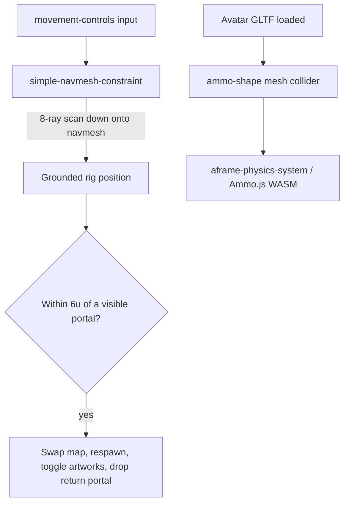

# Transcendence 🥽

A walkable VR art gallery in the browser, with real navmesh-constrained locomotion, Ammo.js physics, and portals that swap you between whole environments.

## Why I built it

I wanted VR movement that felt like walking, not the usual point-and-blink teleport. So Transcendence is an A-Frame WebXR scene where you actually walk a first-person avatar across the ground, held to a navigation mesh, past a set of framed artworks, and step through portals to move between separate worlds. It is a small gallery built to get the locomotion and physics right.

## What it does

- First-person VR locomotion, constrained to a navmesh so you stay on walkable ground
- Physics via Ammo.js compiled to WebAssembly: static level geometry, a falling dynamic body, a mesh collider on the avatar
- Portals that switch the entire environment, not just your position
- 15 framed artworks that appear and disappear per world
- A moving avatar with a particle trail and a footstep loop that react to whether you are moving
- A looping soundtrack

## How it works

The scene is A-Frame. The rig carries `movement-controls` for input and a custom navmesh constraint for grounding, and physics runs on aframe-physics-system with the Ammo.js driver. The navmesh itself was generated with Recast.



### Navmesh-constrained locomotion

The custom `simple-navmesh-constraint` keeps the player grounded by raycasting straight down onto the navmesh every frame. A single downward ray snags on edges and gaps, so instead it fans out a scan pattern of eight samples along the movement direction, from dead ahead out to plus and minus 80 degrees at shrinking distances, and takes the first that lands on the mesh. It then applies its own gravity term, clamped to a maximum fall speed, with a 0.5 unit fall tolerance, so you drop onto lower ledges rather than clip through them. It is cheap raycast grounding rather than a full physics character controller, which is the point: it holds VR framerate while still feeling like walking.

### Ammo.js physics in WebAssembly

Physics runs on aframe-physics-system with the Mozilla Reality build of Ammo.js, compiled to WebAssembly. The level geometry is a `static-body`, a `dynamic-body` box falls under gravity, and the avatar gets an `ammo-shape` mesh collider the moment its GLTF finishes loading, so its collisions use the real mesh instead of a bounding box. Running the solver in WASM is what keeps a mesh collider affordable inside a VR frame budget.

### Portals that swap worlds

Each portal does more than move you. Getting within range hides the current map and its artworks, shows the target map, resets you to that map's spawn point, and repositions a single return portal. That lets four separate environments live in one scene with no page reload, and keeps only the active world's artworks visible.

## Tech stack

- WebXR: A-Frame, aframe-extras (`movement-controls`), aframe-particle-system-component
- Physics: aframe-physics-system (n5ro fork), Ammo.js (WASM, Mozilla Reality build), cannon
- Navigation: Recast-generated navmesh, a custom `simple-navmesh-constraint` component
- Build: Webpack, Babel
- Assets: custom GLTF maps, avatar, and portals; a painted sky; a soundtrack

## Running it

WebXR and camera access need https, so the dev server runs over https.

```bash
yarn install
yarn start        # https://localhost:8080
```

The map, avatar, and portal GLTF assets are loaded from a Glitch CDN; the navmesh and sky are local.

## Status

WebXR VR prototype from 2022. The locomotion, physics, portals, and gallery all run; it is a focused experiment in browser VR movement rather than a shipped app.
