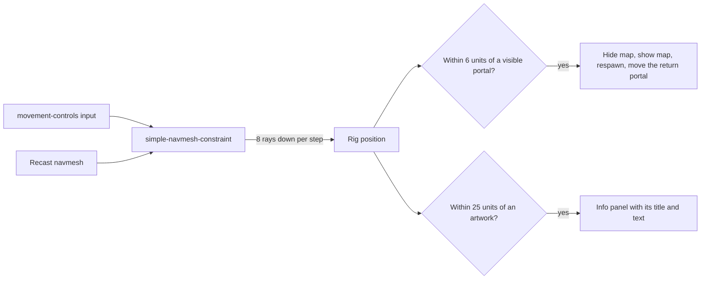

# Transcendence

A walkable art gallery in the browser. You steer an avatar over a navigation mesh, past framed artworks, and portals swap the whole world around you.

## Why I built it

I wanted movement in a browser world that felt like actually walking. So Transcendence is a small gallery built around that: a first-person avatar held to the ground by a navmesh, a wall of artworks that open when you get close, and portals that carry you between worlds.

## What it does

- First-person walking, held to a navmesh so you stay on walkable ground and slide along edges
- Portals that hide the current world, show the next one and drop you at its spawn point
- 15 framed artworks, shown per world, each with a title and a text that open when you walk up to it
- An avatar with a particle trail
- A looping soundtrack

## How it works

The scene is A-Frame 0.8.2. The rig carries `movement-controls` for input and a navmesh constraint for grounding. Everything is one HTML file, three components and the models beside it. There is no build step.



### Walking on a navmesh

`simple-navmesh-constraint` is Ada Rose Cannon's component from aframe-xr-boilerplate. Each step it casts rays straight down onto the navmesh: the full step, half of it, then 30, 60 and 80 degrees to each side at shrinking range. The first ray that hits wins, so you slide along an edge. The navmesh was baked with Recast from the first map.

### Portals that swap worlds

Every frame each portal measures its distance to the rig. Under 6 units it hides the current map and its artworks, shows the target map and writes that map's spawn point into the rig position. All four maps sit in one scene, so a swap loads nothing. A single return portal is moved into each world you enter.

### Artworks that open as you approach

Each artwork checks its distance to the rig. Under 25 units a plain HTML panel over the canvas shows its title and text, and it closes when you walk away.

## Tech stack

- A-Frame 0.8.2, aframe-extras (`movement-controls`, `animation-mixer`), aframe-particle-system-component
- aframe-physics-system (n5ro fork) on its default Cannon driver, for one falling box
- A Recast navmesh and `simple-navmesh-constraint`
- glTF maps, avatar and portal, a painted sky, a soundtrack

## Running it

Any static file server works. The libraries load from CDNs, and every model, texture and sound is a file in this repo.

```bash
npx serve .
# or
python -m http.server 8080
```

Then open the address it prints. Walk with WASD or the arrow keys, and drag to look around.

## Known gaps

- It never enters a headset. The VR button has been off since the first version, and A-Frame 0.8.2 predates WebXR.
- The fourth world cannot be reached: the third portal has no `teleport` component.
- All portals share one model. The green, pink and blue portal models and the second avatar lived only on Glitch's CDN, which no longer serves them.
- The footstep loop is not wired to the rig.

## Status

A browser prototype from 2022. Walking, portals and the gallery all run.
