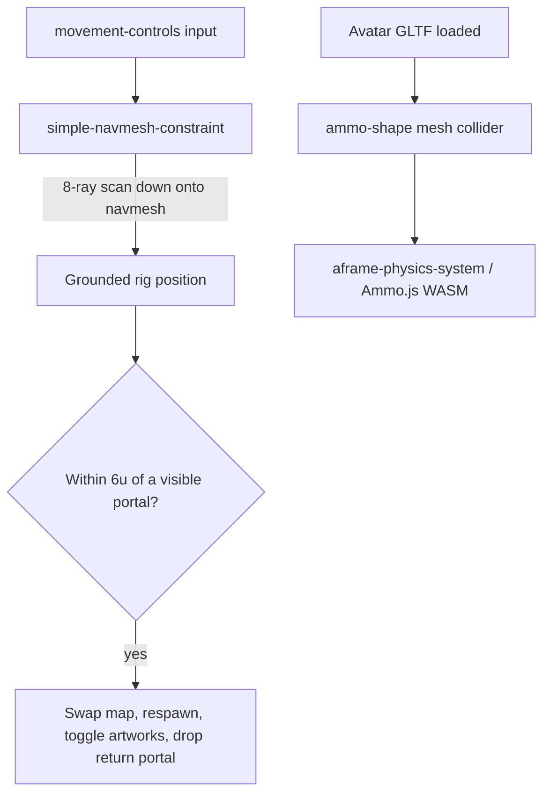

# Transcendence 🥽

A walkable VR art gallery in the browser, with real navmesh-constrained locomotion, Ammo.js physics, and portals that swap you between whole environments.

## Why I built it

I wanted VR movement that felt like actually walking, so Transcendence lets you do that. You steer a first-person avatar across the ground, held to a navigation mesh, past a wall of framed artworks. Portals move you between separate worlds. It is a small gallery built to get the locomotion and physics right.

## What it does

- First-person VR locomotion, constrained to a navmesh so you stay on walkable ground
- Physics via Ammo.js compiled to WebAssembly: static level geometry, a falling dynamic body, a mesh collider on the avatar
- Portals that swap the whole environment and drop you at a new spawn
- 15 framed artworks that appear and disappear per world
- An avatar with a particle trail and a footstep loop that kick in when you move
- A looping soundtrack

## How it works

The scene is A-Frame. The rig carries `movement-controls` for input and a custom navmesh constraint for grounding. Physics runs on aframe-physics-system with the Ammo.js driver. The navmesh was baked with Recast.



### Navmesh-constrained locomotion

The custom `simple-navmesh-constraint` keeps the player grounded by raycasting straight down onto the navmesh every frame. A single downward ray snags on edges and gaps. So it fans out a scan of eight samples along the movement direction, from dead ahead to plus or minus 80 degrees at shrinking distances. It takes the first that lands on the mesh. It then applies its own gravity term, clamped to a max fall speed, with a 0.5 unit fall tolerance, so you land on lower ledges cleanly. This is deliberately cheap. A full physics character controller would blow the VR frame budget; raycast grounding holds framerate and still feels like walking.

### Ammo.js physics in WebAssembly

Physics runs on aframe-physics-system with the Mozilla Reality build of Ammo.js, compiled to WebAssembly. The level geometry is a `static-body`. A `dynamic-body` box falls under gravity. The avatar gets an `ammo-shape` mesh collider the moment its GLTF finishes loading, so it collides on its actual mesh geometry for accurate contacts. Running the solver in WASM is what keeps a mesh collider affordable inside a VR frame budget.

### Portals that swap worlds

Getting within range of a portal hides the current map and its artworks, shows the target map, and resets you to that map's spawn point. It also repositions a single return portal. Four separate environments live in one scene with no page reload. Only the active world's artworks stay visible.

## Tech stack

- WebXR: A-Frame, aframe-extras (`movement-controls`), aframe-particle-system-component
- Physics: aframe-physics-system (n5ro fork), Ammo.js (WASM, Mozilla Reality build), cannon
- Navigation: Recast-generated navmesh, a custom `simple-navmesh-constraint` component
- Build: Webpack, Babel
- Assets: custom GLTF maps, avatar, and portals; a painted sky; a soundtrack

## Running it

WebXR and camera access need https, so the dev server runs over https.

```bash
yarn install
yarn start        # https://localhost:8080
```

The map, avatar, and portal GLTF assets load from a Glitch CDN. The navmesh and sky are local.

## Status

WebXR VR prototype from 2022. The locomotion, physics, portals, and gallery all run. It is a focused experiment in browser VR movement, never shipped as a product.
